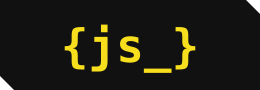

<div align="center">


# JS Motion Lab

**Não apenas aprenda JavaScript. Desenvolva o instinto de pensar em código.**


</div>

---

##  Sobre

O **JS Motion Lab** é uma plataforma interativa e animada para aprender, praticar e medir o seu nível em JavaScript.
Em vez de um curso tradicional, a ideia é aprender **lendo, escrevendo e executando código de verdade**.

Identidade visual: branco, quase-preto e o amarelo do JavaScript (`#F7DF1E`), com estética de programador.

##  Funcionalidades

| Página | O que faz |
|---|---|
| **Home** | Hero com efeito *typewriter*, linhas amarelas animadas, introdução ao JS com código sendo digitado e demonstração problema → solução → testes |
| **Aprender** | Artigos no estilo MDN: visão geral, sintaxe, parâmetros, exemplos, erros comuns e dicas. Sumário com pontinhos sob o artigo aberto, caixas de código com **Copiar** e **Executar** |
| **Training** | Central de exercícios com filtro por categoria, dificuldade, tempo estimado, editor com syntax highlighting, dicas, testes reais e feedback |
| **Level** | Avaliação de nível (6 perguntas progressivas) com pontuação animada, pontos fortes, pontos a melhorar e exercícios recomendados |
| **Profile** | Mapa de atividade estilo GitHub (53 semanas) em tons de amarelo, estatísticas, precisão, sequência, progresso por categoria e histórico |
| **Login** | Cadastro e login locais com animações contínuas sobre JavaScript |
| **Configurações** | Janela modal aberta pelo ícone no header: idioma (com bandeiras), tema, animações, tamanho do código e reset de progresso |

##  Tecnologias

- **HTML5** semântico
- **CSS3**: variáveis, grid, flexbox, animações e temas
- **JavaScript puro (vanilla)**, sem frameworks e sem bibliotecas
- Fontes: [Outfit](https://fonts.google.com/specimen/Outfit) e [JetBrains Mono](https://www.jetbrains.com/lp/mono/)

##  Como funciona por dentro

- **Execução segura de código:** o código do usuário roda em um **Web Worker** (sem acesso ao DOM) e é encerrado após 2 segundos, o que evita laços infinitos travando a página.
- **Exercícios reais:** cada exercício tem casos de teste; o progresso só é salvo quando todos passam.
- **Editor protegido:** a linha da função não pode ser apagada; ao tentar, o editor treme e pisca em vermelho. Comentários são livres.
- **Internacionalização:** dicionário central `T` (EN, PT-BR, ES, FR e DE; o que falta cai para inglês) + atributos `data-i18n`. Adicionar um idioma é adicionar um objeto. O código JavaScript dos exemplos nunca é traduzido.
- **Rotas:** SPA simples com hash (`#/home`, `#/learn`, `#/train`, `#/level`, `#/profile`, `#/login`).
- **Typewriter:** função `typeEl` digita o HTML progressivamente (preservando os destaques amarelos) quando o título entra na tela via `IntersectionObserver`.
- **Persistência:** `localStorage` guarda idioma, tema, progresso, atividade diária e conta.
- **Login local:** a senha é salva como hash SHA-256 (`crypto.subtle`). **Não existe servidor**: as contas ficam apenas no navegador.
- **Acessibilidade:** foco visível, controles por teclado, `aria-*` nos menus, respeito a `prefers-reduced-motion`.
- **Responsivo:** desktop, tablet e celular.

##  Estrutura

```
JS-Lab/
├── index.html        # estrutura da página (HTML semântico)
├── css/
│   └── style.css     # identidade visual, temas, layout responsivo e animações
├── js/
│   └── script.js     # traduções, exercícios, artigos, rotas, progresso e interações
├── assets/
│   └── logo.svg      # logo {js_}
└── README.md
```

> A arquitetura já separa dados (traduções, exercícios, artigos) da lógica, facilitando dividir em `style.css` e `script.js` e plugar um backend.

##  Como rodar

Não precisa instalar nada. Abra o `index.html` no navegador, ou sirva a pasta:

```bash
npx serve .
```

##  Próximos passos

- [ ] Completar a tradução de ES, FR e DE (hoje cobrem a interface principal)
- [ ] Mais exercícios (DOM e Interatividade ainda sem desafios)
- [ ] Mais perguntas na avaliação (incluindo DOM)
- [ ] Backend e contas reais
- [ ] Mais idiomas

##  Autor

**Flávio Caputo**
[LinkedIn](https://www.linkedin.com/in/flaviocaputo/) · [GitHub](https://github.com/FlavioCaputo85) · [Repositório](https://github.com/FlavioCaputo85/JS-Lab)

<div align="center"><sub>Feito com <code>{js_}</code> e muito amarelo.</sub></div>
